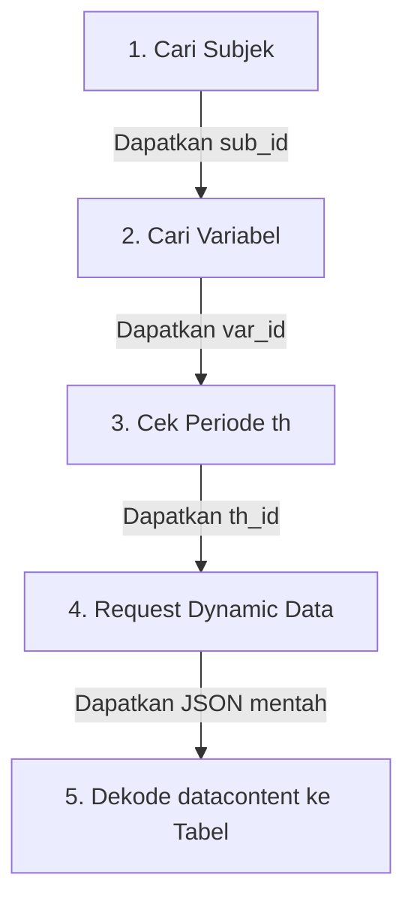

# Panduan Lengkap Dynamic Data & Decoding BPS API

Dynamic Data (`model/data`) adalah layanan BPS API untuk mengambil matriks data statistik numerik.

Karena sifat data BPS adalah multi-dimensi (antar-wilayah, antar-waktu, dan sub-kategori), BPS menyajikan nilainya dalam dictionary `datacontent` dengan format **kunci komposit terenkapsulasi**.

---

## 1. Rumus Kunci Komposit `datacontent`

Setiap entri nilai dalam `datacontent` memiliki format:
```json
"datacontent": {
  "1175301261": 891.8
}
```

Kunci string `"1175301261"` merupakan gabungan dari 5 nilai dimensi (*ID*) yang tertera pada metadata respons:

$$\text{Kunci} = \textbf{vervar} + \textbf{var} + \textbf{turvar} + \textbf{tahun} + \textbf{turtahun}$$

### Bedah Komponen:
1. **`vervar` (Vertical Variable)**:
   * Dimensi vertikal (biasanya nama Provinsi, Kabupaten, atau Klasifikasi Utama).
   * Contoh: `1` = Migas.
2. **`var` (Variable ID)**:
   * ID variabel statistik yang diminta.
   * Contoh: `1753` = Nilai Ekspor Migas-NonMigas.
3. **`turvar` (Turunan Variabel)**:
   * Sub-kategori atau turunan variabel. Jika tidak ada turunan, bernilai `0`.
   * Contoh: `0` = Tidak ada.
4. **`tahun` (Periode Tahun / `th`)**:
   * ID periode tahun (bukan tahun kalender langsung, melainkan ID internal BPS).
   * Contoh: `126` = Tahun 2026.
5. **`turtahun` (Turunan Periode / `turth`)**:
   * Pecahan waktu dari tahun (misal bulan atau triwulan).
   * Contoh: `1` = Januari, `2` = Februari, `0` = Tahunan.

### Hasil Rekonstruksi:
$$\text{"1"} + \text{"1753"} + \text{"0"} + \text{"126"} + \text{"1"} \longrightarrow \textbf{"1175301261"}$$
Artinya:
* Komponen: Migas
* Variabel: Nilai Ekspor Migas-NonMigas
* Periode: Januari 2026
* Nilai: **891.8** Juta US$

---

## 2. Alur Kerja Standar Mengambil Data (5-Step Runbook)

Jika agent ingin mencari data statistik baru (misalnya "Data Pengangguran"), ikuti 5 langkah ini secara berurutan:



### Langkah 1: Cari Subjek (`subject`)
Gunakan CLI:
```bash
python scripts/bps_client.py subject --keyword "ketenagakerjaan"
```
Catat `sub_id` yang sesuai (misal: `sub_id = 6`).

### Langkah 2: Cari Variabel di Bawah Subjek Tersebut (`var`)
Gunakan CLI:
```bash
python scripts/bps_client.py variable --subject 6
```
Catat `var_id` yang diinginkan (misal: `var_id = 54` untuk Tingkat Pengangguran Terbuka).

### Langkah 3: Cari Periode yang Tersedia (`th`)
Periode tahun tidak boleh ditebak, karena setiap variabel memiliki ketersediaan tahun dan ID internal yang berbeda.
```bash
python scripts/bps_client.py period --var 54
```
Output akan menampilkan daftar `th_id` dan label tahun (misal: `th_id = 125` untuk 2025).

### Langkah 4 & 5: Ambil dan Dekode Data Sekaligus
Gunakan perintah `dynamic-data` pada `bps_client.py`:
```bash
python scripts/bps_client.py dynamic-data --var 54 --th 125
```
Script `bps_client.py` akan secara otomatis:
1. Memanggil endpoint BPS.
2. Membaca metadata label untuk setiap dimensi.
3. Mencocokkan setiap nilai di `datacontent`.
4. Mengembalikan tabel bersih dalam format JSON array terstruktur atau tabel Markdown!
