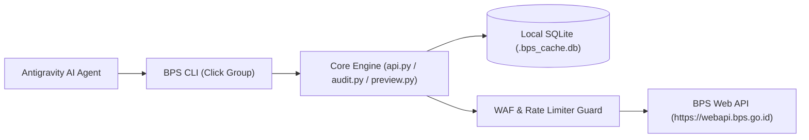

# BPS Web API Architecture Blueprint

Dokumen arsitektur teknis yang menjelaskan alur data, mekanisme rate limit/WAF, dan skema caching BPS Agent-Native Harness.

---

## 1. Topologi Komunikasi

---

## 2. Lapisan Ketahanan Sistem (Resilience Layer)

1. **Exponential Backoff**:
   - Jika menerima HTTP 429 (Too Many Requests) atau HTTP 503, engine melakukan backoff: 1s, 2s, 4s dengan jitter acak.
2. **Atomic Locking (Session History)**:
   - State sesi disimpan di `.bps_session.json` dengan penguncian berkas atomik:
     - Windows: `msvcrt.locking`
     - POSIX: `fcntl.flock`
   - Mendukung 50 level snapshot `undo` dan `redo`.
3. **Content-Addressable Preview (`preview-bundle/v1`)**:
   - Menghitung hash SHA-256 dari parameter data (`var_id`, `th_id`, `domain`).
   - Menyimpan `summary.json` (min, max, mean, median, std_dev) dan sampel data kecil untuk menghemat konsumsi token LLM.
4. **Zero External Dependencies Core**:
   - Client API inti murni menggunakan library standar Python (`urllib.request`, `json`, `sqlite3`, `hashlib`) tanpa ketergantungan paket pihak ketiga, menjamin portabilitas maksimum.
